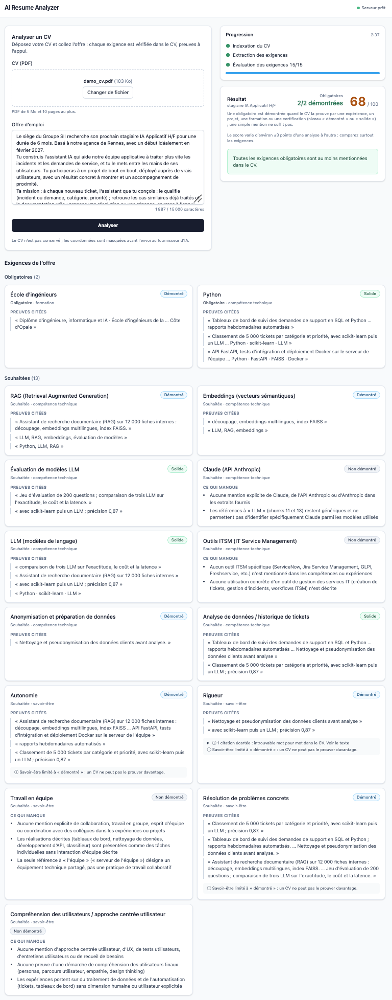
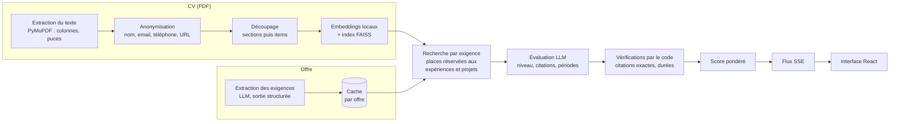

# AI Resume Analyzer

Compare un CV (PDF) à une offre d'emploi, exigence par exigence. Chaque exigence de l'offre (compétences, formation, langues, savoir-être) reçoit un niveau (non démontré, mentionné, démontré, solide) justifié par des **citations exactes du CV, vérifiées par le code**, avec ce qui manque. Le résultat arrive en temps réel, exigence après exigence, et se conclut par un score et la liste des exigences obligatoires non démontrées.

<!-- Capture d'écran : analyse du CV de démonstration (backend/eval/cvs/demo_cv.pdf) sur l'offre
     backend/eval/offers/sii.txt, à enregistrer dans docs/screenshot.png -->


**Stack** : Python 3.13, FastAPI, LangChain, FAISS, PyMuPDF, fastembed (ONNX) · React 19, TypeScript strict, Vite, Tailwind · Server-Sent Events · Docker, Nginx · pytest, Vitest, ruff, oxlint, GitHub Actions.

## Pipeline



1. Le texte du PDF est extrait dans l'ordre de lecture (colonnes détectées, puces rattachées), puis **anonymisé** : seuls des extraits sans nom ni coordonnées quittent la machine.
2. Le CV est découpé selon sa structure (sections, puis un chunk par expérience, projet ou formation) et indexé en local (FAISS, similarité cosinus).
3. Le LLM extrait de l'offre une liste d'exigences atomiques, avec leur importance (obligatoire / souhaitée) et des reformulations pour la recherche ; le résultat est mis en cache par offre.
4. Pour chaque exigence, la recherche retrouve les passages du CV les plus proches, et le LLM rend un niveau, des citations et, si l'offre exige une durée, des périodes.
5. Le code vérifie tout ce qui est vérifiable : citations présentes mot pour mot dans le passage cité, dates présentes dans le CV, durées additionnées. Il rétrograde ce qui ne tient pas, puis calcule le score.
6. Chaque étape est envoyée au navigateur dès qu'elle est prête (Server-Sent Events).

## Choix techniques et compromis

| Choix | Pourquoi | Compromis |
|---|---|---|
| **Embeddings locaux** (fastembed, `multilingual-e5-large`, ONNX) | Le CV n'est envoyé à aucun service d'embeddings ; pas de PyTorch (image plus légère, compatible macOS x86_64) | ~2,2 Go à télécharger une fois ; OpenAI ou Mistral restent configurables |
| **Deux modèles LLM** (`LLM_MODEL`, `MATCH_LLM_MODEL`) | Extraction (un appel) et évaluation (un appel par exigence) n'ont pas les mêmes besoins de qualité et de coût | Un réglage de plus ; avec le quota gratuit Mistral, le même modèle sert aux deux |
| **Citations vérifiées par le code** | Le LLM doit citer le CV mot pour mot ; une citation introuvable est écartée, un niveau sans preuve valide est ramené à « non démontré » | Une reformulation du LLM ferait perdre une preuve : normalisation (casse, accents, typographie, « … » à la place d'un retour à la ligne) et **seconde chance** (si toutes les citations sont rejetées, un appel supplémentaire demande de les recopier mot pour mot ou de baisser le niveau, revérifié avec les mêmes règles) |
| **Durées calculées en Python** | Le LLM relève les périodes ; le code vérifie que leurs dates figurent dans le CV, fusionne les chevauchements et compare à la durée exigée | Seules les périodes explicitement datées comptent |
| **Recherche sensible aux sections** | Les listes de compétences, très proches des requêtes, occupaient tout le top k : des places sont réservées aux expériences et projets, et un passage qui contient le mot exact de l'exigence n'est jamais exclu | Heuristique fondée sur les titres de section |
| **Limiteur partagé** | Tous les appels au LLM passent par un même limiteur (débit, concurrence) ; sur 429, attente adaptée (`Retry-After`, fenêtre par minute, quota de tokens) et toutes les analyses concernées en sont informées | Une analyse dure 2 à 4 minutes avec le quota gratuit |
| **Cache des exigences** | Même offre, mêmes exigences : résultats comparables d'une analyse à l'autre, un appel LLM économisé | En mémoire, par processus ; clé = offre normalisée + modèle + version du prompt |
| **SSE** (plutôt que WebSocket ou polling) | Flux unidirectionnel serveur -> navigateur, simple à relayer (Nginx) ; le navigateur le lit avec `fetch` (POST du CV) et un parseur écrit à la main | Pas de reconnexion automatique (voulu : une coupure n'entraîne jamais une nouvelle analyse) |

Autres garde-fous : l'offre et le CV sont traités comme des **données non fiables** (isolés entre balises, instructions qu'ils contiennent ignorées) ; toute sortie du LLM passe par un modèle Pydantic ; un test de contrat garantit que le frontend comprend chaque événement émis par le backend.

## Évaluation

L'extraction des exigences est évaluée sur deux offres publiques, avec un corrigé par offre (`backend/eval/`), en plusieurs exécutions car le LLM n'est pas déterministe. Résultats avec `mistral-large-4-0` (prompt d'extraction v2, `--runs 3`) :

| Offre | Attendues | Trouvées (moyenne / minimum) | Inventées | Interdites (lieu, dates…) | Erreurs d'importance | Manquées au moins une fois |
|---|---|---|---|---|---|---|
| Hager (stage informatique & IA) | 14 | **100 % / 100 %** | 0 | 0 | 0 | aucune |
| SII (stage IA applicatif) | 13 (+ 3 acceptables) | **92 % / 92 %** | 0 | 0 | 0 | besoins utilisateurs 2/3, analyse de tickets 1/3 |

- **Variance du score** : sur un même CV et une même offre (exigences fixées par le cache), 3 analyses ont donné **48, 48 et 51** ; 11 exigences sur 14 ont le même niveau dans les 3 analyses, dont toutes les compétences techniques obligatoires. Sur le CV de démonstration avec l'offre SII, les scores vont de **60 à 65**. Comptez sur environ ±5 points.
- **Méthode** (corrigé, exigences « acceptables », rapprochement par mots-clés, agrégation de plusieurs exécutions) et limites connues : [backend/eval/README.md](backend/eval/README.md).

## Limites

- **Les citations sont vérifiées, pas leur contenu.** Le code contrôle que chaque preuve citée existe mot pour mot dans le CV (et que les dates d'une durée y figurent), mais il ne peut pas vérifier que ce que dit le CV est vrai : un CV qui affirme une compétence la « prouve » pour l'outil.
- **Le score dépend de la rédaction du CV.** Une compétence décrite dans une expérience ou un projet compte plus qu'un mot dans une liste ; une compétence pratiquée mais non écrite, ou formulée autrement que dans l'offre, peut être manquée. Le score mesure l'adéquation entre le texte du CV et celui de l'offre, pas le niveau réel de la personne.
- **L'évaluation reste celle d'un LLM**, encadrée par des règles : utiliser un service ou un modèle via une API ne prouve pas qu'on sait l'héberger ou l'exploiter, une technologie ne prouve que la compétence qu'elle implique directement, un savoir-être est plafonné à « démontré ». Les cas limites restent possibles ; c'est pourquoi chaque niveau est accompagné de ses preuves et de ce qui manque.
- **L'extraction des exigences n'est pas parfaite** : sur l'offre SII, elle omet parfois une exigence ou en regroupe deux (voir l'évaluation). Le résultat varie aussi d'environ ±5 points d'une analyse à l'autre.
- **Durée** : 2 à 4 minutes par analyse avec le quota gratuit de Mistral (un appel au LLM par exigence, au rythme imposé par le fournisseur). Elle baisse avec un quota plus élevé (`LLM_RPS`).

## Confidentialité

- **Aucune donnée personnelle n'est envoyée au fournisseur d'IA** : le nom, l'email, le téléphone et les URLs sont remplacés par `[NAME]`, `[EMAIL]`, `[PHONE]`, `[URL]` avant toute indexation, et le LLM ne reçoit que des extraits anonymisés (plus le texte de l'offre).
- **Le CV n'est pas conservé** : tout reste en mémoire le temps de l'analyse (aucun stockage, aucun journal de son contenu ; seules des empreintes sha256 en mode debug).
- Avec `EMBEDDINGS_PROVIDER=local` (défaut), les embeddings sont calculés sur la machine.
- Les tests n'utilisent que des données fictives ; le CV de démonstration (`backend/eval/cvs/demo_cv.pdf`) est entièrement inventé et se régénère par script.

## Lancer le projet

Prérequis : une clé API Mistral (offre gratuite suffisante) ou OpenAI.

```bash
cp .env.example .env    # puis renseigner MISTRAL_API_KEY (ou OPENAI_API_KEY et LLM_PROVIDER=openai)
```

`.env.example` active la configuration testée avec le quota gratuit de Mistral : `LLM_MODEL=mistral-large-4-0` et `MATCH_LLM_MODEL=mistral-large-4-0` (les alias `*-latest` et les modèles ministral peuvent être refusés ou limités à 2 requêtes/min sur l'offre gratuite), `LLM_RPS=0.1` (un appel toutes les 10 s, sous la limite de 1 requête/s et de 20 000 tokens/min) et `LLM_RATE_LIMIT_RETRIES=5`. Avec un quota payant, augmentez `LLM_RPS` (par exemple 0,5 à 1, sans dépasser le débit de votre offre) pour raccourcir l'analyse. Avec OpenAI, commentez `LLM_MODEL` et `MATCH_LLM_MODEL`.

### Avec Docker

```bash
docker compose up --build    # puis http://localhost
```

- Deux services : le backend (FastAPI, utilisateur non root) et le frontend (build Vite servi par Nginx, qui relaie `/api` au backend : même origine, pas de CORS). Les routes `/debug/*` sont désactivées (`ENABLE_DEBUG_ROUTES=true docker compose up` pour les réactiver).
- **Premier démarrage** : le modèle d'embeddings (~2,2 Go) est téléchargé dans le volume `models` : mesuré à **70 s** (API joignable via Nginx en 7 s, modèle chargé en 67 s ; volume de 2,25 Go ; dépend de la connexion). L'interface est utilisable pendant ce temps (« Modèle en cours de chargement ») ; une analyse lancée entre-temps attend la fin du chargement. Les démarrages suivants réutilisent le volume : modèle prêt en ~6 s (chargement 1,7 s).
- Images : backend 916 Mo (onnxruntime, FAISS, PyMuPDF, LangChain ; sans le modèle), frontend 82 Mo ; build initial en ~1 min 30.
- Mesuré via Docker (CV de démonstration, offre SII, quota gratuit Mistral, `LLM_RPS=0.1`) : premier événement en 0,1 s, rapport en 3 min 42 s, score 75, obligatoires 2/2 démontrées.

### En développement

```bash
# Backend (Python 3.11+), http://localhost:8000/docs
cd backend
python3 -m venv .venv && source .venv/bin/activate
pip install -r requirements-dev.txt
uvicorn app.main:app --reload

# Frontend (Node.js 20+), http://localhost:5173
cd frontend
npm install
npm run dev
```

En développement, le frontend appelle `http://localhost:8000` (`VITE_API_URL` pour changer) et le backend autorise l'origine `http://localhost:5173` (`CORS_ORIGINS`). Le modèle d'embeddings local est téléchargé au premier démarrage dans `~/.cache/ai-resume-analyzer/fastembed`.

## Configuration

Variables du `.env` (modèle commenté : [.env.example](.env.example)). Seule la clé du fournisseur choisi est exigée ; une variable mal nommée ou en double est signalée au démarrage, avec le nom le plus proche.

| Variable | Rôle | Défaut |
|---|---|---|
| `LLM_PROVIDER` | `mistral` ou `openai` | `mistral` |
| `MISTRAL_API_KEY`, `OPENAI_API_KEY` | clé du fournisseur choisi | aucune |
| `LLM_MODEL` | modèle d'extraction des exigences | `mistral-small-latest`, `gpt-4o-mini` |
| `MATCH_LLM_MODEL` | modèle d'évaluation (un appel par exigence) | `ministral-14b-2512`, `gpt-4o-mini` |
| `LLM_SEED` | graine transmise au fournisseur (vide : aucune) | `42` |
| `LLM_TIMEOUT_S` | délai maximal d'une réponse du LLM | `60` |
| `LLM_RPS`, `LLM_CONCURRENCY` | limiteur partagé : requêtes par seconde, appels simultanés | `0.5`, `4` |
| `LLM_RATE_LIMIT_RETRIES`, `LLM_RATE_LIMIT_BACKOFF_S` | nouvelles tentatives sur 429, attente initiale | `3`, `2.0` |
| `EMBEDDINGS_PROVIDER` | `local`, `openai` ou `mistral` | `local` |
| `EMBEDDINGS_MODEL` | modèle d'embeddings | `intfloat/multilingual-e5-large` (local) |
| `EMBEDDINGS_CACHE_DIR` | dossier du modèle local | `~/.cache/ai-resume-analyzer/fastembed` (`/models` en Docker) |
| `MATCH_K` | passages du CV par exigence | `5` |
| `MATCH_RESERVED_K`, `MATCH_RESERVED_SECTIONS` | places réservées aux expériences et projets ; mots-clés de leurs titres | `3`, `["EXPERIENCE", "PROJET", "STAGE"]` |
| `MATCH_LEVEL_POINTS`, `MATCH_WEIGHTS` | points par niveau, poids par importance (JSON) | 0 / 40 / 75 / 100 ; 2 / 1 / 0,5 |
| `MAX_JOB_OFFER_CHARS`, `MAX_REQUIREMENTS` | taille maximale de l'offre, nombre maximal d'exigences | `15000`, `15` |
| `MAX_PDF_SIZE_BYTES`, `MAX_PDF_PAGES` | limites du PDF | 5 Mo, `10` |
| `REQUIREMENTS_CACHE_SIZE` | offres gardées dans le cache des exigences (0 : désactivé) | `64` |
| `ANALYSIS_CONCURRENCY` | analyses simultanées (429 au-delà) | `2` |
| `ANALYSIS_TIMEOUT_S` | durée maximale d'une analyse | `600` |
| `SSE_PING_S` | intervalle des pings du flux SSE | `15` |
| `CORS_ORIGINS` | origines autorisées (développement) | `["http://localhost:5173"]` |
| `ENABLE_DEBUG_ROUTES` | routes `/debug/*` | `true` (`false` en Docker) |
| `LOG_LEVEL` | niveau des journaux | `INFO` |

## Tests et qualité

```bash
cd backend && pytest                    # tests hors ligne (réseau bloqué, LLM et embeddings simulés)
cd backend && pytest -m integration     # appelle les vrais fournisseurs (clé requise)
cd backend && ruff check . && ruff format --check .
cd frontend && npm test                 # Vitest (fetch simulé avec un ReadableStream)
cd frontend && npm run lint && npm run build   # oxlint, TypeScript strict
```

- **CI** (`.github/workflows/ci.yml`) : les commandes ci-dessus hors intégration, à chaque push et pull request, sans aucun secret.
- **Contrat backend / frontend** : `backend/tests/test_contract.py` produit un exemple de chaque événement SSE à partir des modèles Pydantic (`frontend/src/api/__fixtures__/events.sample.json`) et échoue s'il n'est pas à jour ; Vitest vérifie que le frontend reconnaît chaque exemple. Régénération : `cd backend && UPDATE_CONTRACT_FIXTURES=1 .venv/bin/pytest tests/test_contract.py`.
- **Prompts** : un test vérifie qu'aucun passage des prompts ne vient des cas de référence (offres d'évaluation, CV de démonstration), un autre qu'une modification du prompt d'extraction s'accompagne d'une nouvelle version (clé du cache).
- **Évaluation avec le vrai LLM** (hors CI) : `cd backend && .venv/bin/python eval/eval_requirements.py --offer eval/offers/sii.txt --runs 3`.
- **CV de démonstration** : `cd backend && .venv/bin/python eval/cvs/make_demo_cv.py` (un test vérifie que le PDF du dépôt correspond au script).

## API

`POST /analyze` (multipart : `file`, `job_offer`) renvoie un flux Server-Sent Events :

```bash
curl -N -F "file=@backend/eval/cvs/demo_cv.pdf" -F "job_offer=<backend/eval/offers/sii.txt" \
  http://localhost:8000/analyze
```

```
event: started
id: 1
data: {"type":"started","phases":["indexing","extraction","evaluation"],"timeout_s":600.0}

event: requirements_extracted
id: 2
data: {"type":"requirements_extracted","job_title":"…","requirements":[…],"seconds":21.4,"from_cache":false}

: ping - 2026-11-10 10:12:45.123+00:00

event: requirement_evaluated
id: 4
data: {"type":"requirement_evaluated","result":{…},"done":1,"total":13}
…
event: report
id: 17
data: {"type":"report","report":{"score":…,"missing_mandatory":[…],…}}
```

- Événements : `started`, `cv_indexed`, `requirements_extracted`, `status` (attente imposée par le quota du fournisseur), `requirement_evaluated` (un par exigence), puis `report` ou `error` ; le flux se ferme ensuite.
- Les erreurs de validation sont renvoyées **avant** le flux, en JSON : 400 (PDF invalide), 413 (PDF ou offre trop volumineux), 422 (champ vide), 429 (trop d'analyses en cours), 500 (clé absente), 503 (modèle d'embeddings indisponible).
- Si le client se déconnecte, l'analyse s'arrête et aucun nouvel appel au LLM n'est lancé.
- Autres routes : `GET /health` (avec `embeddings_ready`), `GET /config` (limites publiques), et en développement `/debug/parse`, `/debug/search`, `/debug/requirements`, `/debug/match` (Swagger : http://localhost:8000/docs).

Format détaillé de chaque événement, architecture et conventions : [Structure.md](Structure.md).

## Structure du dépôt

```
backend/
  app/            API FastAPI, extraction PDF, anonymisation, découpage, embeddings, LLM, matching
  tests/          pytest (hors ligne)
  eval/           évaluation de l'extraction (offres, corrigés, CV de démonstration)
frontend/
  src/api/        client HTTP, parseur SSE, types alignés sur le backend
  src/state/      reducer : événements -> état de l'écran
  src/components/ interface React
docker-compose.yml, .github/workflows/ci.yml
```

`CLAUDE.md` et `Structure.md` servent aussi de consignes à l'assistant de code utilisé pendant le développement.

## Licence

[MIT](LICENSE)
